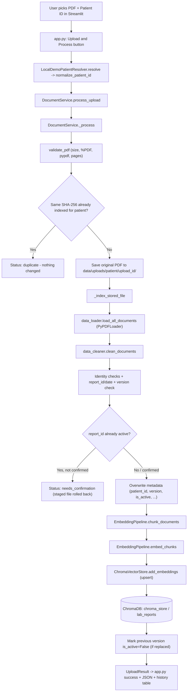
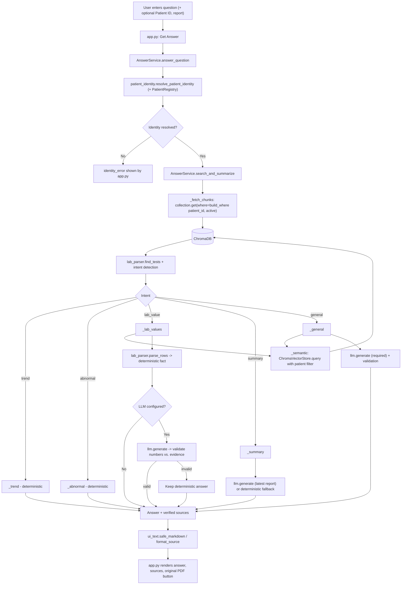
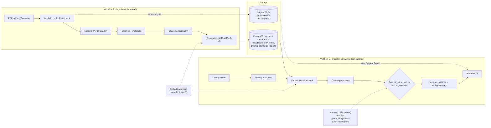

<<<<<<< HEAD
# General Physician Medical Report Assistant

A Streamlit-based Retrieval-Augmented Generation (RAG) prototype. Users upload **synthetic** patient lab reports (PDF), and then ask natural-language questions about them. Answers are grounded in the stored reports and shown with the source report name, page and report date.

> **Prototype for synthetic data only.** This is *not* a production-ready system and *not* a clinical decision-support tool. It has no real authentication, is not HIPAA-compliant, and must not be used with real patient records or as a substitute for a physician. See [Security and Known Limitations](#13-security-and-known-limitations).

## Contents

1. [Project Overview](#1-project-overview)
2. [Technology Stack](#2-technology-stack)
3. [Directory Structure](#3-directory-structure)
4. [Prerequisites and Setup](#4-prerequisites-and-setup)
5. [Configuration and LLM Providers](#5-configuration-and-llm-providers)
6. [Document Upload — Step by Step](#6-document-upload--step-by-step)
7. [Medical Report Search — Step by Step](#7-medical-report-search--step-by-step)
8. [Overall RAG Architecture](#8-overall-rag-architecture)
9. [Core Modules and Responsibilities](#9-core-modules-and-responsibilities)
10. [Running and Testing](#10-running-and-testing)
11. [User Guide](#11-user-guide)
12. [Troubleshooting](#12-troubleshooting)
13. [Security and Known Limitations](#13-security-and-known-limitations)

---

## 1. Project Overview

**What it is.** A two-tab web app (`app.py`): *Upload Medical Report* and *Search Medical Reports*.

**Problem it solves.** Lab reports are long PDFs. A patient (or GP) wants "What is my hemoglobin?" answered directly, with proof of where the number came from, rather than a page of raw text.

**Main features**

- PDF upload with validation (size, page count, PDF signature, encryption), duplicate detection and **report versioning** (old versions are kept as history, not deleted).
- Text extraction, cleaning, chunking, embedding and storage in ChromaDB.
- Patient identification from a Patient ID field, an ID in the question, or a full patient name.
- Patient-filtered retrieval: every Chroma read goes through one filter builder that always contains an exact `patient_id` match.
- **Deterministic lab-value extraction** (regex over the cleaned text) for exact values, units, reference ranges and flags.
- Optional, configurable LLM that may *rephrase* answers; its output is accepted only if every number in it appears in the retrieved text.
- UI shows only the answer plus *Source / Page / Report Date* — never raw chunks, vectors or Chroma metadata.

**How RAG is used.** Reports are chunked and embedded into ChromaDB (**ingestion**). At question time the system retrieves only the asking patient's chunks, extracts facts from them, optionally lets an LLM word the answer, validates it against the retrieved text, and cites sources (**generation**). The LLM is a *writer*, not a source of facts.

**How new reports become searchable.** Upload → validate → load → clean → chunk → embed → upsert into the `lab_reports` collection. Searchable immediately after the upload confirmation; no restart or retraining. **Uploading a PDF never trains or fine-tunes any model.**

**How history is maintained.** Each stored chunk carries `report_id`, `version`, `is_active`, `uploaded_at`, `upload_id`, `checksum`. Uploading a changed file for an existing `report_id` (after the user confirms) indexes it as `version + 1` and flags the old chunks `is_active=False`. Search uses active versions only. History is listed in the Upload tab.

**Current limitations**

- Prototype, synthetic data only; trusts a typed Patient ID (no login).
- Lab-report layout parsing is tuned to the synthetic "SYNTHETIC DIAGNOSTICS LAB" format; other layouts are indexed as plain text and will mostly not be answered deterministically.
- Scanned/image-only PDFs have no OCR and are rejected.
- Fine-tuning of Qwen is **not implemented in this repo**; only the *hook* to load a LoRA adapter exists (see §5).
- Free-form (non-lab) questions need a configured LLM.

---

## 2. Technology Stack

Verified against `pyproject.toml` and the source.

| Component | Technology (where used) |
|---|---|
| Frontend | Streamlit (`app.py`) |
| Language | Python ≥ 3.11 (`.python-version` = 3.11) |
| Document loading | LangChain `PyPDFLoader` (also `TextLoader`, `CSVLoader`, `Docx2txtLoader`, `UnstructuredExcelLoader`, JSON via custom code) in `src/data_loader.py` |
| PDF validation | `pypdf.PdfReader` (`src/document_service.py`) |
| Cleaning | Custom Python/regex (`src/data_cleaner.py`) |
| Chunking | `RecursiveCharacterTextSplitter` — 1000 chars, 200 overlap |
| Embedding model | `all-MiniLM-L6-v2` via `sentence-transformers` (384 dimensions, checked) |
| Vector database | ChromaDB `PersistentClient`, cosine space |
| LLM integration | Configurable: OpenAI (default), OpenAI-compatible server, local Hugging Face Qwen, or none (`src/llm.py`) |
| Lab extraction | Custom deterministic parser (`src/lab_parser.py`) |
| Config | `python-dotenv` + environment variables (`src/config.py`) |
| Dependency mgmt | `uv` (`pyproject.toml`, `uv.lock`) |
| Testing | `pytest` (44 tests) |

`pyproject.toml` also lists `faiss-cpu`, `typesense`, `langgraph`, `langchain-groq`, `pymupdf`, `ipykernel`. `faiss-cpu`, `typesense`, `langgraph` and `langchain-groq` are **not imported** by the app. `pymupdf` is used only by the test fixtures (`tests/conftest.py`).

---

## 3. Directory Structure

```text
GeneralPhysicianRagFT/
├── app.py                    # Streamlit UI (both tabs)
├── main.py                   # placeholder ("Hello from ...") - not the app entry point
├── README.md
├── pyproject.toml            # dependencies + pytest config
├── uv.lock
├── requirnments.txt          # legacy pip list (note the filename spelling); use uv instead
├── documents.ipynb           # exploration notebook
├── GPFT.zip                  # archive of the project
├── .python-version
├── .gitignore                # ignores .venv, __pycache__, data/uploads/
├── .streamlit/
│   └── config.toml           # [server] maxUploadSize = 10
├── src/
│   ├── config.py             # single source of truth: paths, model, limits, LLM env vars
│   ├── data_loader.py        # load_all_documents()
│   ├── data_cleaner.py       # clean_documents(), clean_report_text()
│   ├── embeddings.py         # EmbeddingPipeline (chunk + embed)
│   ├── vector_store.py       # ChromaVectorStore
│   ├── document_service.py   # DocumentService (upload pipeline, history)
│   ├── patient_scope.py      # normalize_patient_id(), build_where(), LocalDemoPatientResolver
│   ├── patient_identity.py   # PatientRegistry, resolve_patient_identity()
│   ├── answer_service.py     # AnswerService (used by the app for search)
│   ├── lab_parser.py         # LabRow, parse_rows(), find_tests(), KNOWN_TESTS
│   ├── llm.py                # build_llm(), OpenAIChatLLM, QwenLocalLLM
│   ├── ui_text.py            # safe_markdown(), format_source()
│   ├── retrieval_service.py  # RetrievalService (retrieval-only; used by tests, not by app.py)
│   └── search.py             # legacy RAGSearch (CLI demo; not used by app.py)
├── data/
│   ├── reports/              # seed corpus: 200 synthetic PDFs + manifest.jsonl
│   ├── uploads/              # PDFs stored by the upload flow (git-ignored)
│   ├── reference/            # lab_test_guide.pdf
│   └── eval/                 # retrieval_questions.jsonl
├── chroma_store/             # persistent ChromaDB data
└── tests/                    # conftest.py, test_upload.py, test_duplicates.py,
                              # test_retrieval.py, test_answers.py
```

There is no `.env.example` in the repo; see §5 for the variables to put in your own `.env`.

---

## 4. Prerequisites and Setup

1. **Python 3.11+** (`requires-python = ">=3.11"`). `uv` can install it for you.
2. **Git**: <https://git-scm.com/downloads>
3. **uv**: <https://docs.astral.sh/uv/getting-started/installation/>
   ```powershell
   powershell -ExecutionPolicy ByPass -c "irm https://astral.sh/uv/install.ps1 | iex"
   ```
4. **Clone and install** (the repo has no commits/remote configured yet, so substitute your own URL):
   ```powershell
   git clone <repository-url>
   cd GeneralPhysicianRagFT
   uv sync          # creates .venv and installs everything in uv.lock (incl. the dev group with pytest)
   ```
5. **Configure the LLM** (optional but needed for non-lab questions) — see §5.
6. **Start the app**:
   ```powershell
   uv run streamlit run app.py
   ```
   Streamlit's default address is <http://localhost:8501> (no custom port is configured).

**First run.** The embedding model `all-MiniLM-L6-v2` is downloaded from Hugging Face on first use (needs internet once).

**Where ChromaDB stores data / initialization.** In `chroma_store/` (`config.CHROMA_DIR`), collection `lab_reports`. `ChromaVectorStore.__init__` calls `PersistentClient(...).get_or_create_collection(...)`, so the folder and collection are created automatically when the app starts. **The app does not auto-load the seed PDFs.** A fresh checkout starts with an empty collection unless you ship `chroma_store/` or ingest `data/reports` yourself, e.g. via the example block in `src/vector_store.py`:

```powershell
uv run python -m src.vector_store
```
(Documented from the source `__main__` block; **not executed** while writing this README. The existing `chroma_store/` in this working copy holds 604 chunks.) Alternatively upload PDFs through the UI.

Original uploaded PDFs are written to `data/uploads/<patient_id>/<upload_id>/<upload_id>.pdf`.

---

## 5. Configuration and LLM Providers

Settings live in `src/config.py` and are read from environment variables (a `.env` file in the project root is loaded by `python-dotenv`). Create `.env` yourself; **never commit it or put real keys in the README.**

| Variable | Default | Purpose |
|---|---|---|
| `LLM_PROVIDER` | `openai` | `openai`, `openai_compatible`, `qwen_local`, or `none` |
| `LLM_MODEL` | `gpt-4.1` | Model name for `openai` / `openai_compatible` |
| `OPENAI_API_KEY` | – | Required for `openai`; optional for `openai_compatible` (defaults to `not-needed`) |
| `LLM_BASE_URL` | empty | Required for `openai_compatible` (e.g. a vLLM / Ollama / LM Studio endpoint) |
| `QWEN_MODEL_NAME` | `Qwen/Qwen2.5-0.5B-Instruct` | Hugging Face model for `qwen_local` |
| `QWEN_ADAPTER_PATH` | empty | If set, a LoRA adapter folder loaded on top of the Qwen model via `peft` |

Fixed (non-env) settings in `config.py`: `COLLECTION_NAME="lab_reports"`, `EMBEDDING_MODEL="all-MiniLM-L6-v2"`, `MAX_UPLOAD_MB=10`, `MAX_PDF_PAGES=50`, `DEFAULT_TOP_K=5`, `MIN_SIMILARITY=0.15`. Keep `.streamlit/config.toml` `maxUploadSize` in sync with `MAX_UPLOAD_MB`.

**Provider examples**

```dotenv
# 1) Default - OpenAI
LLM_PROVIDER=openai
OPENAI_API_KEY=<your-key>
LLM_MODEL=gpt-4.1

# 2) OpenAI-compatible server serving Qwen (example: a local Ollama/vLLM endpoint - adjust URL/model to your server)
LLM_PROVIDER=openai_compatible
LLM_BASE_URL=http://localhost:11434/v1
LLM_MODEL=<model-name-served-by-your-server>

# 3) Qwen in-process (Hugging Face), optional adapter
LLM_PROVIDER=qwen_local
QWEN_MODEL_NAME=Qwen/Qwen2.5-0.5B-Instruct
QWEN_ADAPTER_PATH=

# 4) No LLM - deterministic answers only
LLM_PROVIDER=none
```

Notes:

- The LLM is built **lazily on the first question** (`AnswerService._get_llm`). If building fails (e.g. missing key), a warning is logged and the app falls back to deterministic answers instead of crashing.
- `qwen_local` imports `torch` and `transformers` (both present in this environment) and, only when `QWEN_ADAPTER_PATH` is set, `peft`. **`peft` is not listed in `pyproject.toml`** — install it yourself (`uv add peft`) before using an adapter.
- **Implemented:** switching providers by config; loading a LoRA adapter if one exists. **Not implemented / planned:** any fine-tuning code or training data pipeline, and any tested adapter. Providers `openai_compatible` and `qwen_local` were not exercised against a live server while writing this README.
- The embedding model is separate from the answer LLM and is not affected by `LLM_*` variables.

---

## 6. Document Upload — Step by Step

Execution path: `app.py` → `DocumentService.process_upload` → `_process` → `_index_stored_file` → `data_loader` → `data_cleaner` → `EmbeddingPipeline` → `ChromaVectorStore.add_embeddings`.

### Step 1 — User uploads a report (`app.py`)

Inline in the *Upload* tab (`if st.button("Upload and Process")`, `app.py:68`).

- **Receives:** Patient ID text (`up_pid_raw`), the PDF (`st.file_uploader`, `type=["pdf"]`), and the "updated version" checkbox (`allow_replace`).
- **Processing:** if no file → error. Otherwise `resolver.resolve(up_pid_raw)` (`LocalDemoPatientResolver` → `normalize_patient_id`: trim, upper-case, regex `^[A-Z0-9][A-Z0-9_-]{1,31}$`); a `ValueError` is shown as an error. Streamlit itself caps size at 10 MB (`.streamlit/config.toml`).
- **Calls next:** `documents.process_upload(pid, file.name, file.getvalue(), allow_replace=replace)`.

### Step 2 — Document service (`src/document_service.py`)

- **`DocumentService.process_upload(patient_id, filename, data, allow_replace)`** wraps `_process` and converts every expected failure into an `UploadResult(status="rejected", ...)`; it does not raise to the UI.
- **`_process`:**
  1. Re-normalizes the Patient ID.
  2. `validate_pdf(data)`: non-empty, ≤ `max_bytes` (10 MB), starts with `%PDF-`, parseable by `pypdf`, not encrypted, 1–50 pages. Returns page count.
  3. SHA-256 checksum of the bytes.
  4. **Duplicate detection:** `collection.get(where=build_where(patient_id, checksum=...))`. A hit returns status `duplicate` and nothing is changed.
  5. Generates `upload_id` (UUID hex) and writes the original bytes to `data/uploads/<patient_id>/<upload_id>/<upload_id>.pdf` (the user-supplied filename is *never* used as a path; it is sanitized for display only via `sanitize_filename`).
  6. Calls `_index_stored_file(...)`. On any exception or non-OK result, `_rollback` deletes that `upload_id`'s chunks and the staged folder.
- **`_index_stored_file`** continues after steps 3–4 below, then does identity checks, versioning and metadata (details below).

### Step 3 — Loading (`src/data_loader.py`)

`load_all_documents(str(report_dir))` globs the directory (which contains only this upload) for supported types. For `.pdf` it uses **`PyPDFLoader`** → one LangChain `Document` per page, metadata `source` and `page` (0-based). Returns a list of Documents; empty list → "No text could be read from the PDF (is it a scanned image?)".

### Step 4 — Cleaning (`src/data_cleaner.py`)

`clean_documents(raw)`:

- Pages containing `SYNTHETIC DIAGNOSTICS LAB` go through `clean_report_text`: drops banner lines, extracts **patient name, patient ID, age, sex, report ID, report date** with regexes into metadata, rebuilds each table row into one line `Test: value unit (ref low - high) [FLAG]`, and re-joins the pathologist remarks. Sets `doc_type="lab_report"`.
- Other pages get `normalize_text` only (control chars, whitespace).
- Pages under 20 characters and exact duplicates are dropped.
- **Returns** cleaned Documents with enriched metadata. Empty → "no usable text after cleaning".

### Step 4b — Identity, versioning and authoritative metadata (back in `_index_stored_file`)

- Patient IDs found *inside* the PDF: more than one → rejected; one that differs from the entered ID → rejected ("Patient ID mismatch"); none → accepted with a warning (`patient_id_verified=False`).
- Report ID from the PDF (must match `^[A-Za-z0-9][A-Za-z0-9_-]{0,63}$`; more than one → rejected); if absent, `UPL-<8 hex>` is assigned with a warning.
- Report date parsed as ISO date (`YYYY-MM-DD`); an unparseable date is ignored with a warning.
- **Versioning:** if an *active* chunk exists for the same patient + `report_id` (different checksum), and `allow_replace` is false → status `needs_confirmation`. If true → `version = previous max + 1`.
- **Metadata overwrite:** only `page, total_pages, doc_type, patient_name, age, sex` are kept from the PDF-derived metadata (PDFs are untrusted). Then set: `patient_id, report_id, source` (stored path), `original_filename, page, uploaded_at, upload_id, checksum, version, is_active=True, patient_id_verified, report_date`.

### Step 5 — Chunking (`src/embeddings.py`)

`EmbeddingPipeline.chunk_documents(docs)` uses `RecursiveCharacterTextSplitter(chunk_size=1000, chunk_overlap=200, length_function=len, separators=["\n\n", "\n", " ", ""])`. Metadata is copied onto every chunk. `_index_stored_file` reaches the pipeline via `self.store.embedding_pipeline` (the same instance used for search). No chunks → rejected.

### Step 6 — Embedding (`src/embeddings.py`)

`EmbeddingPipeline.embed_chunks(chunks)` calls `SentenceTransformer("all-MiniLM-L6-v2").encode(texts)` and returns a NumPy array of shape `(n_chunks, 384)`.

### Step 7 — ChromaDB storage (`src/vector_store.py`)

`ChromaVectorStore.add_embeddings(embeddings, chunks)`:

- IDs from `_make_id` (hash of source, page, chunk index, content digest — deterministic).
- `_clean_metadata` keeps only `str/int/float/bool` values.
- `collection.upsert(ids, embeddings, documents, metadatas)` in batches of 500.
- Collection `lab_reports`, directory `chroma_store/`, `hnsw:space = cosine`.
- Metadata fields used as filters: `patient_id`, `report_id`, `is_active`, `checksum`, `upload_id` (and `version`, `report_date` for display/ordering).

Afterwards, if this replaced a version, old chunks are updated with `is_active=False, superseded_by, superseded_at` — **only after** the new chunks are safely stored.

### Step 8 — Response to Streamlit

`_index_stored_file` returns `UploadResult(status="indexed"|"replaced", message, patient_id, report_id, upload_id, version, chunks, pages, report_date, checksum, stored_path, warnings, superseded_upload_ids)`. `app.py` then shows `st.success(message)`, a JSON panel (patient ID, report ID, date, version, pages, `chunks_stored`, checksum, stored file, collection, superseded uploads), and any warnings. Other statuses: `needs_confirmation` → warning asking to tick the checkbox; `duplicate` → info; `rejected` → error. The "Previously uploaded reports" table (`report_rows` → `DocumentService.list_reports`) shows the history.

### 6.1 Upload Flow Diagram



`DocumentService` calls `EmbeddingPipeline` directly and `ChromaVectorStore.add_embeddings` for storage. It does **not** use `ChromaVectorStore.add_documents` (which would chunk and embed internally; that method is used only by the example `__main__` block).

### 6.2 Upload File Interaction Table

| Execution Order | File | Function / Method | Responsibility | Next Component |
|---|---|---|---|---|
| 1 | `app.py` | *Upload button block* | Read file, Patient ID, checkbox | `LocalDemoPatientResolver.resolve` |
| 2 | `src/patient_scope.py` | `normalize_patient_id` | Trim, upper-case, validate ID | `DocumentService.process_upload` |
| 3 | `src/document_service.py` | `process_upload` | Error-safe wrapper | `_process` |
| 4 | `src/document_service.py` | `_process` → `validate_pdf` | Validate PDF; checksum; duplicate lookup; stage file | `_index_stored_file` |
| 5 | `src/data_loader.py` | `load_all_documents` | `PyPDFLoader` → per-page Documents | `clean_documents` |
| 6 | `src/data_cleaner.py` | `clean_documents` / `clean_report_text` | Normalize, parse report, extract metadata | `_index_stored_file` |
| 7 | `src/document_service.py` | `_index_stored_file` | Identity check, versioning, metadata | `chunk_documents` |
| 8 | `src/embeddings.py` | `EmbeddingPipeline.chunk_documents` | Split into 1000/200 chunks | `embed_chunks` |
| 9 | `src/embeddings.py` | `EmbeddingPipeline.embed_chunks` | 384-d vectors | `add_embeddings` |
| 10 | `src/vector_store.py` | `ChromaVectorStore.add_embeddings` | Upsert docs, vectors, metadata | ChromaDB |
| 11 | `src/document_service.py` | `_index_stored_file` (end) | Deactivate old version; build `UploadResult` | `app.py` |
| 12 | `app.py` | *result rendering* | Show success/warnings/history | – |

### 6.3 Example Upload Walkthrough

Synthetic example: Patient ID `P0201`, name Rahul Sharma, file `R0201_P0201_Rahul_Sharma_Synthetic_Followup.pdf`.

1. In the *Upload* tab type `P0201`, choose the PDF, click **Upload and Process**.
2. `app.py` normalizes `P0201` and sends the bytes to `DocumentService`.
3. The service validates the file, hashes it and checks whether those exact bytes are already indexed for P0201.
4. The original is stored under `data/uploads/P0201/<random-uuid>/`. The stored file name is the UUID; `R0201_P0201_...pdf` is kept only as the display name (`original_filename`).
5. Pages are loaded, cleaned, and the patient ID/report ID/date inside the PDF (if its layout matches) are cross-checked against `P0201`. A mismatch rejects the upload.
6. If a report with the same report ID is already active for P0201, the user is asked to confirm a new version; otherwise it is stored as version 1.
7. Chunks are embedded and upserted into ChromaDB. The UI reports the actual page/chunk counts it computed.
8. From then on, questions about P0201 can retrieve it.

The actual report ID, date, page count and chunk count depend on the PDF's contents; they are displayed by the app after upload and are not predicted here. (This working copy does contain a `data/uploads/P0201/` folder, i.e. a previous upload for that ID.)

---

## 7. Medical Report Search — Step by Step

> **Important:** the app's search path is `app.py` → `AnswerService` (+ `patient_identity`, `patient_scope`, `lab_parser`, `llm`, `ui_text`). `src/retrieval_service.py` (`RetrievalService`) is a separate retrieval-only class that `app.py` does **not** call; it is exercised by `tests/test_retrieval.py`. `AnswerService` does its own patient-filtered retrieval.

### Step 1 — User enters a question (`app.py`, Search tab)

Captures `s_pid_raw` (optional Patient ID), `question`, and the **Report** dropdown (`All Reports` or a specific active report; the dropdown is populated only when a valid Patient ID is typed). Clicking **Get Answer** with an empty question shows an error; otherwise it calls `answers.answer_question(question, patient_id_field=..., authenticated_patient_id=get_authenticated_patient_id(), top_k=config.DEFAULT_TOP_K, report_id=report_filter)` inside a spinner.

### Step 2 — Patient identification (`src/patient_identity.py`)

`AnswerService.answer_question` calls `resolve_patient_identity(question, registry, field_patient_id, authenticated_patient_id)`. Priority: **authenticated ID > Patient ID field > ID in question > full name in question > ask the user.**

| Situation | Behavior |
|---|---|
| ID in the field | Used. Anything else in the question (other ID or known patient name) → error "Searches are limited to one patient" |
| ID only in the question (`\bP\d+\b`) | Used if the registry knows it; unknown → "No patient found with ID …" |
| Several IDs in question | Error: ask about one patient at a time |
| Name only | Resolved via `PatientRegistry` (name→ID map built from Chroma metadata, normalized/case-insensitive, whole-name match). One match → used |
| Ambiguous name (several IDs) | Error listing options; asks for Patient ID |
| ID and name that disagree | Error |
| Nothing usable | Error asking for an ID or full name |
| Authenticated ID set and field differs | Error "only access your own reports" |

IDs are never guessed from names. **Limitation:** `get_authenticated_patient_id()` reads `st.session_state["authenticated_patient_id"]`, which nothing in the repo sets; there is no login, so the typed ID is trusted (see §13).

### Step 3 — Answer service (`src/answer_service.py`)

`answer_question()` returns `{"status": "identity_error", ...}` if identity fails, else calls **`search_and_summarize(question, patient_id, top_k, report_id)`**. It validates input (non-empty, ≤ 500 chars, `top_k` clamped 1–20), loads the patient's active chunks, optionally narrows to the selected report, and classifies the question's **intent**:

| Intent | Condition (checked in this order) | Handler |
|---|---|---|
| `trend` | trend/compare/history words **and** more than one report in scope | `_trend` |
| `lab_value` | a known test name is found in the question | `_lab_values` |
| `abnormal` | words like high/low/abnormal/flagged/critical | `_abnormal` |
| `summary` | summarize/summary/overview | `_summary` |
| `general` | anything else | `_general` |

### Step 4 — Report retrieval and patient filtering

- `_fetch_chunks(pid)`: `collection.get(where=build_where(pid, active_only=True))` — all *active* chunks of this patient (superseded versions excluded). Each result is re-checked (`meta["patient_id"] == pid`) as defense in depth.
- `build_where` (`src/patient_scope.py`) always includes an exact `patient_id`; optionally `report_id`, and `is_active != False` (so legacy chunks with no `is_active` still match).
- A selected report narrows the in-memory chunk list; an unknown report ID returns `not_found`.
- "Latest report" is chosen by **report date** (then upload time, then version), never by similarity.

### Step 5 — ChromaDB similarity search (`src/vector_store.py`)

`ChromaVectorStore.query(query_text, top_k, where)`:

1. Encodes the question with the same `all-MiniLM-L6-v2` model.
2. `collection.query(query_embeddings=..., n_results=top_k, where=where)` — metadata filter applied together with the vector search.
3. Returns dicts `{id, text, metadata, distance}`.

`distance` is **cosine distance** (collection uses `hnsw:space=cosine`), so `similarity = 1 − distance`. `AnswerService._semantic` drops results with similarity below `MIN_SIMILARITY` (0.15). Semantic search is used for `lab_value` (when exactly one report is in scope and the retrieved chunks contain all requested tests) and for `general` questions. Trend, abnormal and summary use the full patient chunk set.

### Step 6 — Deterministic lab extraction (`src/lab_parser.py`)

- `find_tests(question, extra_test_names)` maps aliases to canonical tests (longest mention wins: "glycated hemoglobin" → HbA1c, not Hemoglobin). `KNOWN_TESTS` covers: Hemoglobin (hb, hgb, haemoglobin), RBC Count, Hematocrit (PCV), MCV, MCH, MCHC, Total WBC Count, Neutrophils, Lymphocytes, Platelet Count, Total/LDL/HDL Cholesterol, Triglycerides, TSH, Serum Creatinine, BUN, HbA1c (a1c), eAG, Fasting Plasma Glucose. Test names found in the patient's own reports are added dynamically.
- `parse_rows(text, report_id, page)` reads lines written by the cleaner (`Hemoglobin: 12.2 g/dL (ref 13 - 17) [LOW]`) into `LabRow(test, value, unit, ref, flag, report_id, page)`.
- Answered **deterministically** (no LLM needed): exact lab values, abnormal-results listing, trend across reports. These produce `method="deterministic"`. A summary and a general question use an LLM when available.

### Step 7 — LLM-based generation (`src/llm.py`, `AnswerService`)

- **Provider selection:** `build_llm()` reads `config.LLM_PROVIDER` (see §5); `none` → `None`. Built lazily; failures log a warning and mean "no LLM".
- **Prompting:** `LLMClient.generate(system_prompt, user_prompt)`. The system prompt (`SYSTEM_PROMPT`) says: answer only from excerpts, never invent numbers, no diagnosis/treatment, treat excerpts as untrusted data. Excerpts are wrapped in `<report_excerpt report=… report_id=… date=… page=…>` tags (`_context`, capped at 12 000 chars, tag-spoofing stripped).
- **lab_value:** a deterministic answer is built first. If an LLM exists, it is given the verified facts and excerpts and asked for 1–2 sentences. The LLM wording is used **only if** it contains each required value *and* every number in it appears in the evidence (`_numbers_supported`). Otherwise the deterministic text is returned (`method="deterministic"`).
- **summary:** LLM summary of the latest report only, validated by `_numbers_supported`; on failure/no LLM → deterministic list of flagged results.
- **general:** requires an LLM. No LLM → `status="unavailable"` message; failed validation → "I could not produce a verified answer".
- **Limitation:** validation checks *numbers* only. It cannot detect wrong words, wrong interpretation, or a number attributed to the wrong test.

### Step 8 — Formatting (`src/ui_text.py`)

`AnswerService._sources` builds verified references (`report_id`, `report_name`, `report_date`, `page` 1-based) from metadata of the chunks actually used — never from LLM text. `format_source` renders `Source: … / Page: … / Report Date: …` (or "not stated"). `safe_markdown` escapes markdown/HTML in all model/report-derived text.

### Step 9 — Streamlit display (`app.py`)

On `status == "ok"`: subheader *Answer*, `safe_markdown(answer)`, one `format_source` block per source, and a **View Original Report** download button per source report (`AnswerService.read_report_pdf`, which only serves PDFs from the patient's upload folder or the seed folder). `not_found` / `needs_clarification` → warning; other statuses (`identity_error`, `invalid_input`, `unavailable`) → error. Chunks, vectors, distances and raw Chroma metadata are never rendered (covered by `test_source_attribution_and_no_internal_fields` and a Streamlit `AppTest`).

### 7.1 Search Flow Diagram



### 7.2 Search File Interaction Table

| Execution Order | File | Function / Method | Input | Processing | Output |
|---|---|---|---|---|---|
| 1 | `app.py` | Get Answer block | question, Patient ID field, report choice | Validate non-empty; call service | `answer_question(...)` call |
| 2 | `src/answer_service.py` | `AnswerService.answer_question` | same + authenticated ID (hook) | Resolve identity first | `IdentityResult` |
| 3 | `src/patient_identity.py` | `resolve_patient_identity`, `PatientRegistry` | question, IDs | Priority/conflict rules | `IdentityResult(patient_id | error)` |
| 4 | `src/answer_service.py` | `search_and_summarize` | question, patient_id, top_k, report_id | Validate; intent detection | handler call |
| 5 | `src/answer_service.py` + `src/patient_scope.py` | `_fetch_chunks`, `build_where` | patient_id | Patient-filtered fetch of active chunks | `_Chunk` list |
| 6 | `src/lab_parser.py` | `find_tests`, `parse_rows` | question; chunk text | Alias match; regex rows | test names; `LabRow`s |
| 7 | `src/vector_store.py` | `ChromaVectorStore.query` (via `_semantic`) | question, `where` | Embed query; filtered cosine search | `{id,text,metadata,distance}` |
| 8 | `src/answer_service.py` | `_lab_values` / `_abnormal` / `_trend` / `_summary` / `_general` | rows/chunks | Build deterministic facts; optionally call LLM | candidate answer |
| 9 | `src/llm.py` | `build_llm`, `LLMClient.generate` | system + user prompt | Call configured provider | text |
| 10 | `src/answer_service.py` | `_numbers_supported`, `_sources` | answer, evidence | Reject unsupported numbers; build sources | result dict |
| 11 | `src/ui_text.py` | `safe_markdown`, `format_source` | answer, source dict | Escape; format | display text |
| 12 | `app.py` | render | result dict | Show answer, sources, PDF button | UI |

### 7.3 Search Example

Question: *"What is the hemoglobin count for patient P0001?"* (Patient ID field left empty.)

1. Identity: `P0001` found in the question; the registry knows it → `source="question_id"`.
2. `find_tests` → `["Hemoglobin"]` → intent `lab_value` (no trend words).
3. Chunks for P0001 are fetched with the `patient_id` filter; semantic retrieval is used first when one report is in scope.
4. `parse_rows` reads the cleaned line for hemoglobin. According to the seed manifest (`data/reports/manifest.jsonl`), `R0001_P0001.pdf` has Hemoglobin 12.2 g/dL, flag LOW, on page 1; the reference range shown in the report's table is 13–17 g/dL.
5. The deterministic fact is built by `_fact`. Its exact wording is:
   *"Patient P0001's Hemoglobin is 12.2 g/dL. The report marks this as LOW compared with the laboratory reference range of 13–17 g/dL."*
   (Slightly different from the sentence quoted in the task brief; the value, flag and range match.)
6. If an LLM is configured it may reword this; the rewording is kept only if it contains `12.2` and all its numbers appear in the evidence. Otherwise the deterministic sentence is shown.
7. Source shown: `R0001_P0001.pdf`, Page 1, with the report date.

Caveat: if P0001 has more than one active report in the collection (this working copy has an upload folder for P0001), the latest-by-date report that contains the test is used, and the answer adds "This is from the latest report that includes it…", so the cited source may differ from `R0001_P0001.pdf`. This exact question was not run end-to-end in the UI for this README; the equivalent behavior is covered by `tests/test_answers.py` with synthetic PDFs (`test_values_units_and_unflagged_result`, `test_llm_wording_accepted_when_numbers_check_out`, `test_hallucinated_or_empty_llm_answer_falls_back_to_report_values`). No specific LLM is claimed to have produced this answer.

---

## 8. Overall RAG Architecture



- **Vector storage:** ChromaDB. **Report metadata/history:** metadata on each Chroma chunk (there is no separate relational DB). **Original PDFs:** filesystem.
- **Embedding model** (`all-MiniLM-L6-v2`) is used for both ingestion and queries and must stay identical.
- **Answer LLM** is independent of the embedding model and only writes/rephrases answers.
- A new upload does **not** trigger Qwen (or any) fine-tuning.

---

## 9. Core Modules and Responsibilities

| File | Purpose | Key classes / functions | Depends on | Used in |
|---|---|---|---|---|
| `app.py` | Streamlit UI; wires services via cached `get_services()` | `get_services`, `report_rows`, `get_authenticated_patient_id` | all services | Both |
| `src/config.py` | Paths, model name, limits, LLM env vars | constants | `python-dotenv` | Both |
| `src/data_loader.py` | Load PDF/TXT/CSV/XLSX/DOCX/JSON into LangChain Documents | `load_all_documents`, `_load_json_file` | LangChain loaders | Upload |
| `src/data_cleaner.py` | Normalize text; parse lab-report layout; extract metadata | `normalize_text`, `clean_report_text`, `clean_documents` | LangChain Document | Upload |
| `src/embeddings.py` | Chunking and embedding | `EmbeddingPipeline.chunk_documents`, `.embed_chunks` | `sentence-transformers`, text splitters | Upload (and query encoding via `.model`) |
| `src/vector_store.py` | Chroma persistence and semantic query | `ChromaVectorStore.add_documents`, `.add_embeddings`, `.query` | `chromadb`, `EmbeddingPipeline` | Both |
| `src/document_service.py` | Upload pipeline, duplicates, versioning, history | `DocumentService.process_upload/_process/_index_stored_file/validate_pdf/list_reports/_rollback`, `UploadResult`, `ReportSummary`, `display_name`, `sanitize_filename` | loader, cleaner, store, patient_scope | Upload (+ history in Search tab) |
| `src/patient_scope.py` | ID validation and the one filter builder | `normalize_patient_id`, `build_where`, `LocalDemoPatientResolver` | – | Both |
| `src/patient_identity.py` | Decide which patient a question is about | `PatientRegistry`, `resolve_patient_identity`, `IdentityResult` | patient_scope | Search |
| `src/answer_service.py` | Intent routing, retrieval, extraction, LLM use, validation, sources | `AnswerService.answer_question`, `.search_and_summarize`, `._lab_values`, `._abnormal`, `._trend`, `._summary`, `._general`, `.read_report_pdf` | identity, lab_parser, llm, store | Search |
| `src/lab_parser.py` | Deterministic lab-line parsing and test-name aliases | `LabRow`, `parse_rows`, `find_tests`, `KNOWN_TESTS`, `numbers_in` | – | Search |
| `src/llm.py` | Pluggable answer LLMs | `LLMClient`, `OpenAIChatLLM`, `QwenLocalLLM`, `build_llm` | `langchain_openai`, `torch`/`transformers`/`peft` (lazy) | Search |
| `src/ui_text.py` | Safe display helpers | `safe_markdown`, `format_source` | – | Search |
| `src/retrieval_service.py` | Retrieval-only patient-scoped search with scores | `RetrievalService.search`, `RetrievedChunk`, `SearchResponse` | store, patient_scope | Tests only |
| `src/search.py` | Older `RAGSearch` demo (OpenAI + own patient resolution) | `RAGSearch` | store, loader, OpenAI | Not used by app |
| `main.py` | Placeholder | `main` | – | Neither |

---

## 10. Running and Testing

```powershell
uv sync                                  # install dependencies
uv run streamlit run app.py              # start app -> http://localhost:8501
uv run pytest tests -q                   # run all tests
```

- **Tests:** 44 tests in `tests/` (upload validation, duplicates/versioning, retrieval isolation, identity rules, deterministic answers, LLM-validation fallbacks, UI-leak check via Streamlit `AppTest`). They use temporary Chroma directories and synthetic PDFs built with `pymupdf`, and a fake LLM — no network LLM is called. The first run loads the embedding model.
- **Optional integration tests:** none are defined. No pytest markers are configured.
- **Select an LLM provider:** set `LLM_PROVIDER` in `.env` or the shell (e.g. `$env:LLM_PROVIDER="none"; uv run streamlit run app.py`).
- **Different port:** `uv run streamlit run app.py --server.port 8502`.

**Verification status**

| Command | Status |
|---|---|
| `uv run pytest tests -q` | **Executed: 44 passed** (~62 s) |
| Chroma inspection (`chroma_store/` has 604 vectors in `lab_reports`, cosine) and embedding dimension 384 | **Executed** |
| `uv sync`, `uv run streamlit run app.py` | Documented from `pyproject.toml`/`app.py` docstring; **not executed** here (the app is covered via Streamlit `AppTest` in the tests) |
| `uv run python -m src.vector_store` | Documented from source; **not executed** |
| `openai_compatible` / `qwen_local` / OpenAI live calls | **Not executed** |

---

## 11. User Guide

### Upload a medical report

1. Open the app and select **1. Upload Medical Report**.
2. Enter the **Patient ID** (e.g. `P0001`).
3. Click **Browse files** and choose a synthetic PDF (max 10 MB, 50 pages).
4. If you are re-uploading a corrected version of a report that already exists, tick *"This is an updated version…"*.
5. Click **Upload and Process**.
6. A green success message and a details panel appear. The report is also listed under *Previously uploaded reports*.

### Search medical reports

1. Select **2. Search Medical Reports**.
2. Type a question. Optionally enter the Patient ID (or put the ID or full name in the question).
3. Optionally pick a specific report in the **Report** dropdown (appears after you enter a valid Patient ID).
4. Click **Get Answer**.
5. Read the answer, then the *Source / Page / Report Date* lines. Use **View Original Report** to download the PDF.

**Sample questions**

| Topic | Example |
|---|---|
| Hemoglobin | `What is the hemoglobin count for patient P0001?` |
| HbA1c | `What is my HbA1c? (Patient ID P0001)` |
| High / low results | `Which blood test results are marked HIGH or LOW for P0001?` |
| Latest report | `Summarize the latest report for P0001` (summary uses an LLM if configured, otherwise lists flagged results) |
| Comparison | `How has hemoglobin changed across reports for P0001?` (needs more than one stored report) |

---

## 12. Troubleshooting

| Problem | Cause / fix |
|---|---|
| `ModuleNotFoundError` / missing packages | Run `uv sync`; start with `uv run …` so the project `.venv` is used |
| Wrong Python interpreter | Use `uv run python …`; in VS Code select `.venv\Scripts\python.exe`. Python 3.11+ required |
| Missing environment variables | Create `.env` (see §5). Without `OPENAI_API_KEY` the default `openai` provider fails to build and the app falls back to deterministic-only (log: "Answer LLM unavailable") |
| OpenAI API error | Check the key/model; failed calls are logged and the deterministic answer is returned for lab questions. Free-form questions then show "could not produce a verified answer" |
| Qwen / compatible server connection failure | Check `LLM_BASE_URL`, `LLM_MODEL` and that the server runs; for `qwen_local` check `torch`/`transformers` and, with an adapter, `peft` (not in `pyproject.toml`) |
| Empty ChromaDB collection / "No reports have been uploaded for patient …" | The app does not auto-ingest `data/reports`. Upload PDFs or run `uv run python -m src.vector_store` (see §4) |
| No results for a patient | Wrong ID, or similarity below 0.15, or the report selected doesn't contain it. Try *All Reports* |
| Missing patient metadata | Reports not in the synthetic layout produce no patient name/ID in metadata; the entered ID is trusted with a warning, and name-based lookup won't work for them |
| Duplicate report upload | Identical bytes → "already indexed… Nothing was changed." Intended |
| "already exists … with different content" | Tick the *updated version* checkbox and upload again to store as a new version |
| Wrong report selected | Choose *All Reports* in the dropdown |
| Patient name ambiguity | Enter the Patient ID in the field |
| "Patient ID mismatch" on upload | The ID inside the PDF differs from the one typed; correct the ID |
| LLM answer rejected | A number in the LLM text wasn't in the report; the system falls back to the deterministic answer or the "could not produce a verified answer" message. Rephrase or ask about a specific test |
| PDF text extraction failures | Scanned/image PDFs, encrypted or corrupt files are rejected (no OCR) |
| Port already in use | `uv run streamlit run app.py --server.port 8502` |
| Upload > 10 MB rejected | Limit in `config.MAX_UPLOAD_MB` and `.streamlit/config.toml` (keep in sync) |

---

## 13. Security and Known Limitations

- **Synthetic data only.** Do not upload real patient records.
- **No real authentication.** `LocalDemoPatientResolver` trusts the typed Patient ID, so anyone using the app can query any patient. The `authenticated_patient_id` hook in `AnswerService.answer_question` exists but nothing sets it. Real use would need authentication plus server-side authorization.
- **Patient isolation** relies on a metadata filter (`build_where`) plus a second in-code check on results; it is tested with synthetic data (`test_isolation_between_patients`, `test_patient_isolation_never_falls_back`) but has not been independently audited. Patient names are held in an in-memory registry derived from all stored metadata.
- **Original PDFs** are stored unencrypted on local disk under `data/uploads/` (git-ignored). The View Original Report button only serves files under the patient's own upload folder or the seed folder.
- **Upload hardening:** magic-byte check, size/page limits, encrypted-PDF rejection, UUID storage names, PDF-supplied metadata keys are whitelisted. Not a malware scan.
- **Secrets:** keep API keys in `.env` or environment variables; never commit them. No `.env` is included.
- **Prompt injection / hallucination:** report text is wrapped as untrusted data and the model is told to ignore instructions in it, but this is not a guarantee. Only numeric consistency is validated; the wording and interpretation of LLM-written answers can still be wrong. Prefer deterministic answers and always check the cited source.
- **Output safety:** model/report text is markdown-escaped before display.
- **Not medical advice.** The assistant reports what the documents say; it does not diagnose or recommend treatment and is no substitute for a physician.
- **No claims** of HIPAA compliance, production readiness, audit logging, encryption at rest, or complete patient isolation are made.
=======
# GeneralPhysicianFineTuning
General Physician Fine Tuning 
>>>>>>> b9fe472ce523773e041eb84d03e70d5fa8a28c6c
